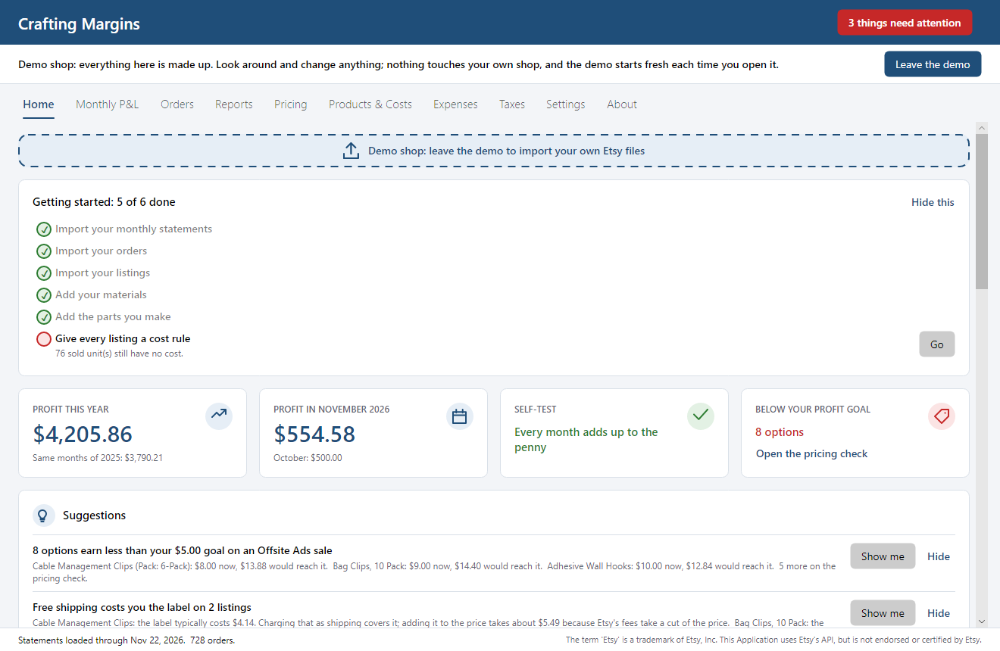
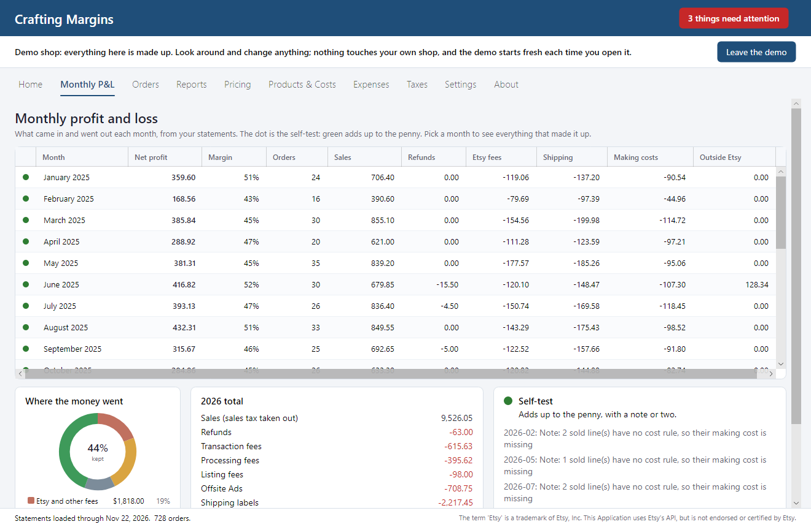
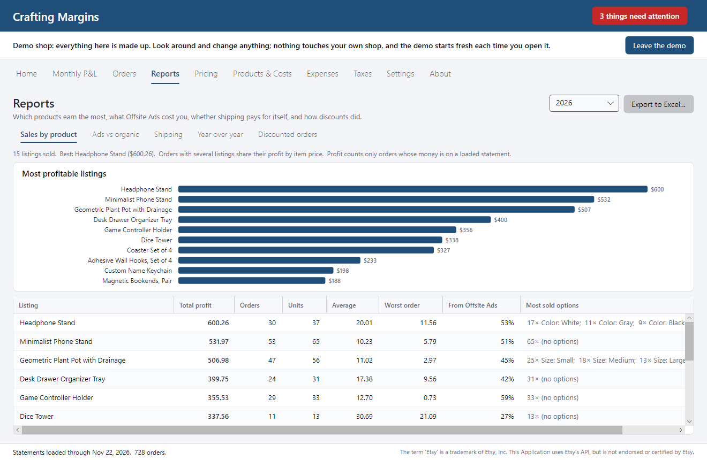
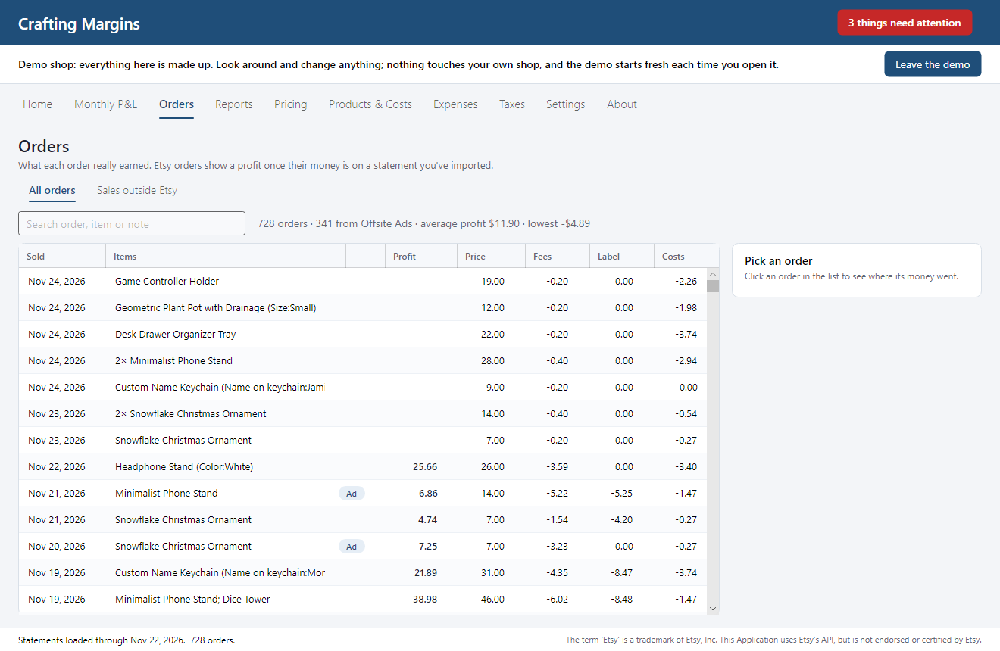
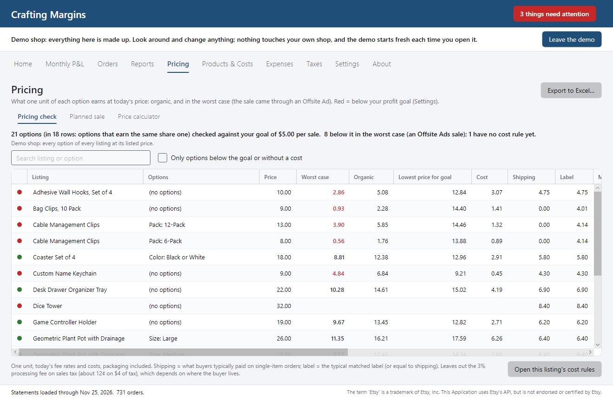
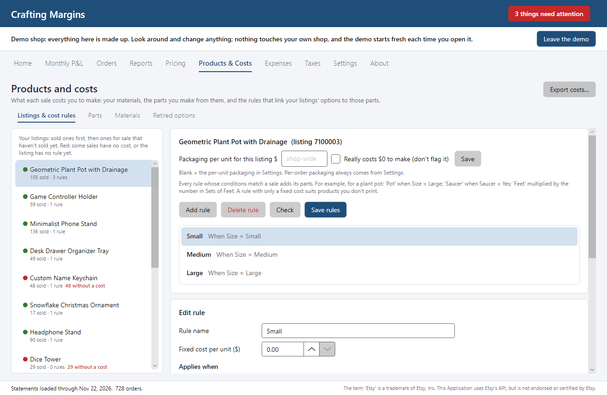
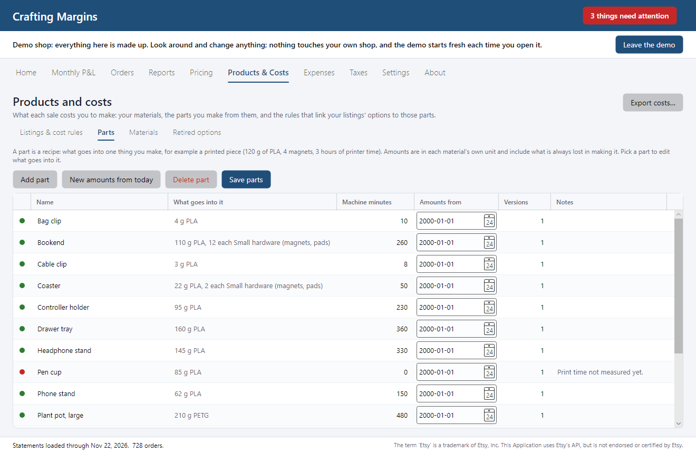

# Crafting Margins

A free, open-source desktop app for Windows and macOS that shows Etsy sellers what each sale really earned after every Etsy fee, Offsite Ads, the shipping label, and what it cost to make. It was built for a 3D-printing shop and works for any maker who can say what goes into a product: candles and soap, yarn and fabric, wood, resin, jewelry.



> The term 'Etsy' is a trademark of Etsy, Inc. This Application uses Etsy's API, but is not endorsed or certified by Etsy.

**Version 0.9.1.** [CHANGELOG.md](CHANGELOG.md) lists what changed in each version.

## What it does

- **Home**: profit this year and this month, a self-test that checks every month adds up to the penny, how many options are below your profit goal, profit by month for the last 12 months, and where this year's money went. **Suggestions** point out what your numbers show: options below your goal (with the price that fixes each), free shipping that costs you the label, how Offsite Ads orders compare with the rest, which listings earn the most per hour of making time, and how discounted orders compare with full-price ones.
- **Monthly P&L**: every Etsy money movement, month by month.
- **Orders**: what each order really earned, line by line. **Sales outside Etsy** (craft fairs, direct sales) can be added by hand and count everywhere.
- **Reports**: sales by product, Offsite Ads vs organic, shipping charged vs label cost, year over year, and discounted orders. Export to Excel.
- **Pricing**: what one unit of every option earns at today's price, with the lowest price that meets your profit goal; a *planned sale* view at a percent off; and a *price calculator* for a product you haven't listed yet.
- **Products & Costs**: what goes into each thing you make, and which listing uses what.
- **Expenses**: purchases that aren't on your Etsy statement (materials, boxes, equipment).
- **Taxes**: a year-end summary by month, as plain categories or grouped by suggested Schedule C line, with a check against your Etsy 1099-K. Export to Excel or CSV.

| | |
|---|---|
|  |  |
|  |  |
|  |  |

The pictures are of the made-up demo shop.

## Good to know first

- **Not tax or financial advice.** Crafting Margins does arithmetic on your Etsy data. Check important numbers against your Etsy statements, and talk to a tax professional about your filing.
- **Free, with no support.** Nobody is paid to answer questions or fix things. It's shared as it is, in the hope it's useful. [CONTRIBUTING.md](CONTRIBUTING.md) says how to report a problem.
- **Made for US shops.** It was designed for Etsy shops in the United States that are paid in US dollars. You're welcome to use it elsewhere, but VAT, other currencies and the fees Etsy charges outside the US weren't taken into account, so files from those shops may not import and the numbers may not be right.

## Download and install

Downloads are on the [Releases](../../releases) page. There's nothing to install and nothing else to download: each one includes everything it needs.

### Windows

1. Download `Crafting_Margins_<version>_Windows.exe` (about 50 MB, for 64-bit Windows 10 or 11) and keep it anywhere you like.
2. Run it. The first time, Windows shows **"Windows protected your PC"**. Click **More info**, then **Run anyway**. You won't see this again.

### Mac

1. Download the zip for your Mac: `Crafting_Margins_<version>_macOS_Apple_Silicon.zip` or `Crafting_Margins_<version>_macOS_Intel.zip`. To check which you have, open the Apple menu → **About This Mac**: "Chip: Apple M…" means **Apple silicon**; "Processor: Intel" means **Intel**. It needs macOS 15 (Sequoia) or later.
2. Open the zip and drag **Crafting Margins** into your **Applications** folder.
3. Open it. The first time, macOS says it can't check the app for malicious software. Click **Done**.
4. Open **System Settings → Privacy & Security**, scroll down to the message about Crafting Margins, and click **Open Anyway**. Enter your Mac password if asked, then click **Open**. You won't see this again.

The Mac version passes every automated test on macOS, but it is newer than the Windows one. If something doesn't work, please [report it](CONTRIBUTING.md).

### Why the warning?

Windows and macOS show this warning for any program whose maker hasn't been verified by Microsoft or Apple. That verification is a paid yearly service meant for commercial software. Crafting Margins is a free project made for fellow sellers, so it doesn't use it. The warning doesn't mean anything is wrong with the program, only that the operating system doesn't know who made it, and you'll only see it the first time.

To be sure your download is the real one, compare its checksum with the one listed on the release page. In the folder you downloaded it to:

- Windows (PowerShell): `Get-FileHash Crafting_Margins_*_Windows.exe -Algorithm SHA256`
- Mac (Terminal): `shasum -a 256 Crafting_Margins_*_macOS_*.zip`

The same 64 characters mean the file is exactly what was published.

## Getting started

Want to look around first? **Explore a demo shop first** on the welcome screen (or later, **Settings → Program settings → Open the demo shop**) opens a made-up shop with almost two years of sales. It starts fresh each time and never touches your own data.

1. **Say what you make.** The first-run screen asks. It only sets starting points: the unit new materials start in, the names of your first expense categories, and whether machine time is tracked. You can change it in Settings.
2. **Bring in your Etsy data**, in either or both of these ways:
   - **Connect to Etsy** (Settings → Etsy API). The app pulls your orders, listings and payments straight from Etsy and keeps them up to date by itself. It's the only way to check every option of every listing at today's price. Setting it up takes about ten minutes; see [Connecting to Etsy](#connecting-to-etsy) below.
   - **Download files from Etsy** and drop them on the Home tab (several at once is fine). All four come from Shop Manager:

     | File | Where in Shop Manager | What the app uses it for |
     |---|---|---|
     | **Monthly statements** | Finances → Monthly statements → Download CSV (one per month) | Every fee and payment: the Monthly P&L and the tax summary |
     | **Sold Orders** | Settings → Options → Download Data → Orders, type *Orders* → Download CSV | Each order's totals, shipping and discounts |
     | **Sold Order Items** | The same place, type *Order Items* → Download CSV | What was in each order, with its options, so costs can be matched |
     | **Listings** | Settings → Options → Download Data → *Currently for sale listings* → Download CSV | Which listings and options are still for sale, for the pricing check and for costing listings that haven't sold yet |

   **Monthly statements are worth downloading either way.** They're Etsy's official record of every fee and payment, so the Monthly P&L and the tax summary are built from them. Importing a month again replaces it.
3. **Enter your costs** on Products & Costs:
   - **Materials**: anything you buy and use up, each in its own unit (grams, ounces, yards…), or "each" for things bought by the piece, like magnets, wicks and jars.
   - **Parts**: what goes into one thing you make, and optionally how long it takes.
   - **Rules**: which parts each listing uses, by option. Listings that haven't sold yet are there too, so a new product can be costed before its first order.

   Each table has its own Save button, and a red "Unsaved changes" note shows beside it until you save. **Export costs** saves your materials, parts and rules as three CSV files you can keep as a backup or edit in a spreadsheet; drop them on Home to bring them back.

The **Getting started** checklist on Home ticks these off as you go. Anything the app can't place, such as a sale with no cost rule or a statement line it doesn't recognize, is listed under **Needs attention** at the bottom of Home, and a red button appears at the top of the window. The app never guesses.

## Connecting to Etsy

There's no shared key: you register your own free **Seller App** with Etsy, which can only see your own shop. **Settings → Etsy API** walks you through the same steps.

1. Go to [etsy.com/developers/your-apps](https://www.etsy.com/developers/your-apps) while signed in to your shop and create an app.
   - Choose the **Seller App** type (tools for your own shop). Approval is automatic and usually takes minutes.
   - Name: anything of your own (don't use "Etsy" in it).
   - Application purpose, suggested: *"Bookkeeping and profit tracking for my own shop; read-only."*
2. Once Etsy approves it, the app's page shows a **keystring** and a **shared secret**. Etsy doesn't ask for a callback URL when you create the app, so **edit the app**, add `http://localhost:3003/callback` as its callback URL, and save. If Etsy insists on https, use `https://localhost:3003/callback` and change it under **Settings → Etsy API → Advanced** to match; after you approve in step 3, your browser then shows an error page, and you copy its address into the app.
3. Under **Settings → Etsy API**, enter the keystring and shared secret, then **Connect**. Etsy's own page opens in your browser; the app never sees your Etsy password.
4. **Sync now**. After that, the app syncs by itself on start whenever the last sync is more than 6 hours old.
5. **Ledger compare** (optional): Etsy doesn't say what its payment ledger's entry types mean. Pick a month you also have a statement for and compare; the app learns each type from the matching statement lines, and **Use these categories** saves that. Only then turn on *Fill months that have no statement CSV from the API ledger*. A statement always wins over API data for the same month.

The app only asks for permission to read (`transactions_r`, `listings_r`, `shops_r`). The shared secret and sign-in tokens are kept encrypted (Windows) or in your login keychain (Mac), never in the database, settings, backups or logs. Etsy asks you to connect again about every 90 days, and may switch off an app that hasn't been used for 6 months; if that happens, register a new one.

## Your data

- **Everything stays on your computer**, in one folder: `Documents/Crafting Margins` unless you move it (**Settings → Program settings → Move to another folder**). The About tab shows which folder is in use.
- **Never stored:** buyer names, user IDs, emails and addresses.
- **Backups** are made when the app closes, if anything changed. The newest 3 are kept (Settings: 0 to 10; 0 turns them off), and Settings can put them in another folder, such as OneDrive or a USB drive. Each backup is one file and includes your category rules and settings.
- **Network:** the app only goes online for the Etsy API (if you connect it) and, once at start, to check this project's GitHub page for a newer version. It never downloads anything by itself, and Settings can turn the check off.
- **One copy at a time:** only one copy of the app can have a data folder open, because two would overwrite each other's changes.

## Settings worth knowing

- **Appearance** (Settings → Program settings): light, dark or follow your computer; blue or teal; and a focus outline for moving around tables with the keyboard.
- **Numbers** are typed and shown the way your computer's region writes them (1,234.56 in the US, 1.234,56 in Germany), always with a $ because the data is in US dollars. Dates are typed as 2026-10-31 or picked from a calendar.

## Building from source

Requires the [.NET 10 SDK](https://dotnet.microsoft.com/download).

```powershell
dotnet build
dotnet test
dotnet run --project src/CraftingMargins.App
```

- **Windows program:** `dotnet publish src/CraftingMargins.App -c Release -r win-x64 -o publish` makes one self-contained `Crafting Margins.exe`.
- **Mac app:** on a Mac, `packaging/macos/make-app.sh osx-arm64` (or `osx-x64` for Intel) builds `Crafting Margins.app` with its icon and zips it. GitHub builds both when a version is tagged (`.github/workflows/mac-app.yml`).
- Setting the `CRAFTING_MARGINS_DATA` environment variable points the app at another data folder, which is handy for testing.

Projects:

- `CraftingMargins.Core`: fee math, categories, cost rules, reports. No screens and no files.
- `CraftingMargins.Data`: SQLite storage, CSV import, backups, and the Etsy API client.
- `CraftingMargins.App`: the Avalonia screens, one file per tab in `Views`.
- `tests/CraftingMargins.Tests`: xUnit tests on made-up data only. The UI tests open the real screens on the demo shop without a display; set `CRAFTING_MARGINS_SCREENSHOTS` to a folder to save a picture of every tab.

Every push is built and tested on Windows and macOS by GitHub (`.github/workflows/build.yml`).

## License

Copyright © 2026 ADY Designs, LLC.

This program is free software: you can redistribute it and/or modify it under the terms of the GNU General Public License as published by the Free Software Foundation, either version 3 of the License, or (at your option) any later version. It is distributed in the hope that it will be useful, but WITHOUT ANY WARRANTY; without even the implied warranty of MERCHANTABILITY or FITNESS FOR A PARTICULAR PURPOSE. See the [LICENSE](LICENSE) file for the full text.

**Not covered by the GPL:** the ADY Designs name, and the Crafting Margins name and icon, belong to ADY Designs, LLC. If you share a modified version, give it your own name and icon, keep the copyright notices, and don't present it as coming from ADY Designs. Details, plus the licenses of the libraries the app uses, are in [NOTICE.md](NOTICE.md).
